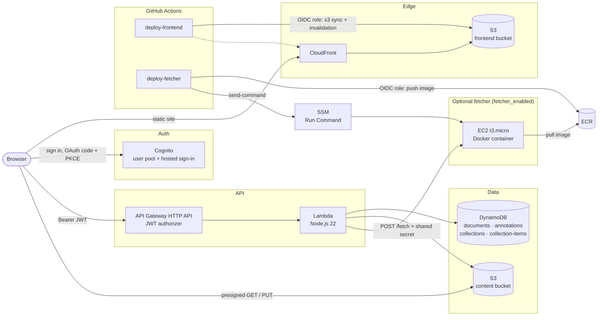

# Annotate

A read-it-later app for saving web articles and PDFs, highlighting them, and organizing highlights into collections. It runs on a serverless AWS stack defined entirely in Terraform.

**Live:** https://d2oze8terylg78.cloudfront.net
**Demo login (read-only):** `brianna.pischke+demo@gmail.com` / `<DEMO PASSWORD>`

## Features

- **Save articles and PDFs.** Paste a link. Web pages are cleaned into a readable view with Mozilla Readability. PDFs keep their original layout through PDF.js.
- **Highlights and notes.** Select text to highlight it. Highlights with a note show as an underline, and hovering shows the note.
- **Collections.** A highlight can belong to any number of collections. Each collection page groups its highlights by article.
- **Area snips.** Drag a box over a chart or table, on a web page or a PDF, to save it as an image. Pasting or dropping an image also works.
- **Accounts.** Cognito sign-up and sign-in. Each user's articles, highlights, notes, snips and collections are private to them, even when two users save the same link. The demo account is read-only, enforced by the API.
- **Duplicate detection.** The same article saved from different links (tracking parameters, `www.`, arXiv `abs` vs `pdf`) is recognized as one article.

## Architecture



**How a save works:** the browser sends `POST /documents` with the user's Cognito access token. API Gateway checks the JWT before the Lambda runs. The Lambda normalizes the URL, fetches and parses the page (or hands it to the EC2 fetcher when that's enabled), stores the cleaned HTML and any original PDF in S3, and writes the metadata to DynamoDB. When reading, the browser gets the article text from the API. PDFs and snip images come straight from S3 through short-lived presigned URLs.

## Tech stack

| Layer | Tools |
| --- | --- |
| Frontend | React 19, TypeScript, Vite, PDF.js (`pdfjs-dist`), DOMPurify, html-to-image, `react-oidc-context` |
| API | API Gateway HTTP API with a Cognito JWT authorizer, AWS Lambda (Node.js 22, ES modules) |
| Parsing | Mozilla Readability + linkedom (web pages), unpdf (PDF text) |
| Data | DynamoDB (4 tables, on-demand billing), S3 (private content bucket) |
| Auth | Amazon Cognito: user pool, managed login, authorization code flow with PKCE |
| Hosting | S3 + CloudFront with Origin Access Control (the bucket isn't public) |
| Fetcher | Node.js in Docker on EC2 (Amazon Linux 2023), images in ECR, deploys via SSM |
| Infrastructure | Terraform (AWS provider 6.x) |
| CI/CD | GitHub Actions with OIDC federation to IAM (no stored AWS keys) |
| Testing | Vitest + jsdom, run in CI before every frontend deploy |

## Engineering highlights

**Snipping images from other sites (with SSRF protection).**
*Problem:* a snip is drawn from the page into a canvas. Images from other sites make the canvas unreadable, and many image hosts block cross-origin requests.
*Solution:* images inside the snip box are fetched through an authenticated `GET /image-proxy` route and swapped in temporarily. Because that route fetches arbitrary URLs server-side, it resolves DNS and rejects private, loopback, link-local and cloud-metadata addresses. It follows redirects manually and re-checks every hop, accepts only `image/*` responses, and caps the size at 4 MB.

**Uploads that bypass Lambda.**
*Problem:* Lambda payloads are capped at 6 MB, and routing image bytes through a function costs time and money.
*Solution:* the API returns a 5-minute presigned S3 `PUT` URL scoped to `<user>/snips/<docId>/<uuid>.png`, and the browser uploads directly. When the snip is saved, the backend verifies that the key sits under the caller's own prefix. PDFs and snip images are read the same way, through 1-hour presigned `GET` URLs, while the bucket stays fully private.

**Authentication at the edge, data scoped per user.**
*Problem:* every route needs a verified identity without auth code repeated in each handler.
*Solution:* an API Gateway JWT authorizer validates the Cognito token's issuer and audience before the Lambda is invoked. The handler reads the verified `sub` claim and uses it as the DynamoDB partition key for documents and collections, as part of the key for collection memberships, and as the S3 key prefix for article HTML, PDFs and snip images. Highlights, notes and snips carry the owner's ID and are checked on every read and write (see the next section). Users can only reach their own data. The same check lets the API reject every non-GET request from the demo account.

**Closing a cross-user access gap.**
*Problem:* an article's ID is a hash of its normalized URL, so two users who save the same link share a `docId`. Highlights were stored under that `docId`, which meant one user could see another's highlights and notes on a shared article, and anyone who knew a highlight's ID could edit or delete it. Deleting an article also removed every user's highlights on it.
*Solution:* an ownership audit of every route. Highlight reads filter on the caller's ID. Updates and deletes use DynamoDB `ConditionExpression`s on `userId`, so the ownership check and the write happen in one atomic step. Someone else's highlight returns 404, the same as a missing one, so IDs can't be probed. Deleting an article removes only the caller's highlights, snip images and collection memberships, and collection pages ignore any highlight the caller doesn't own. A Vitest suite runs the real Lambda handler against in-memory DynamoDB and S3 fakes. In it, two users save the same article and the tests check that neither can see, change or delete the other's highlights, notes, snips or collections. Against the old code, 6 of the 9 tests fail.

**CI/CD without stored AWS keys.**
*Problem:* long-lived access keys in GitHub secrets are a standing credential-leak risk.
*Solution:* GitHub Actions authenticates through an IAM OIDC identity provider. The deploy role trusts only this repository's `main` branch and has least-privilege permissions. It can sync one bucket, invalidate one distribution, push to one ECR repository, and run `AWS-RunShellScript` only on instances tagged as the fetcher. The frontend pipeline runs the Vitest suite before building and deploying.

**Highlights that survive re-renders.**
*Problem:* DOM positions aren't stable. The article is re-sanitized and re-rendered, and PDF text layers are rebuilt on every zoom.
*Solution:* each highlight is stored as a text anchor: the exact quote plus 30 characters of prefix and suffix. When rendering, the app searches the article text for the quote, scores each match against the prefix and suffix, and wraps the best match in `<mark>` elements across however many text nodes it spans. Web articles and PDFs use the same anchoring code.

**Duplicate detection through URL normalization.**
*Problem:* the same article saved from slightly different links created duplicates.
*Solution:* a tested `normalizeUrl` function (forces https, strips `www.`, fragments, tracking parameters and trailing slashes, maps arXiv `abs`/`pdf`/version links to one canonical PDF URL) feeds a deterministic SHA-256 document ID. A title match after fetching catches anything that still slips through.

**Keeping Terraform and the console in agreement.**
*Problem:* some settings are better managed outside Terraform. The Cognito sign-in page is styled in the AWS console's visual editor, and AWS publishes new Amazon Linux AMIs regularly. Both made `terraform apply` want to undo or rebuild things.
*Solution:* targeted `lifecycle { ignore_changes = [...] }` blocks on the Cognito branding and the EC2 instance's AMI. Terraform keeps owning everything else, but no longer reverts the console design or replaces the server on an AMI release.

## Running it

### Prerequisites

Node.js 22, Terraform 1.6 or newer, and the AWS CLI with credentials for the target account (everything deploys to `us-east-1`).

### 1. Deploy the infrastructure

```bash
cd backend/documents && npm ci && cd ../..   # Lambda dependencies are zipped with the code
cd infra
terraform init
terraform apply                              # add -var fetcher_enabled=true for the EC2 fetcher
```

Terraform zips `backend/` into the Lambda functions. Re-running `terraform apply` is also how backend changes get deployed. The EC2 fetcher is off by default because it costs money while running. Without it, the Lambda fetches pages itself.

### 2. Run the frontend locally

Create `frontend/.env.local` from the Terraform outputs (`terraform output`):

```bash
VITE_API_URL=<api_url>
VITE_COGNITO_AUTHORITY=<cognito_authority>
VITE_COGNITO_CLIENT_ID=<cognito_client_id>
VITE_COGNITO_DOMAIN=<cognito_domain>
```

```bash
cd frontend
npm ci
npm run dev    # http://localhost:5173 (already allowed by the API's CORS and Cognito's callback URLs)
npm test       # Vitest
```

### 3. Automated deploys (GitHub Actions)

Pushes to `main` deploy automatically:

- **Changes under `frontend/`** run `deploy-frontend`: test, build, `s3 sync`, then a CloudFront invalidation.
- **Changes under `fetcher/`** run `deploy-fetcher`: build and push the Docker image to ECR, then tell the EC2 instance to pull and restart it through SSM.

Set these repository **variables** (not secrets; none of them are credentials) from the Terraform outputs:

`AWS_ROLE_ARN`, `S3_BUCKET`, `CLOUDFRONT_DISTRIBUTION_ID`, `API_URL`, `COGNITO_AUTHORITY`, `COGNITO_CLIENT_ID`, `COGNITO_DOMAIN`, `FETCHER_REPO_URL`

The deploy role in `infra/github.tf` trusts a specific repository. Update its `sub` condition if you fork the project.

## Repository layout

```
frontend/   React app (reader, highlights, collections, snips) and Vitest tests
backend/    Lambda functions: documents (the API) and hello (the first test endpoint)
fetcher/    Dockerized article-fetching service for EC2
infra/      Terraform for every AWS resource
scripts/    One-off data migrations (e.g. single → multi-collection highlights)
.github/    Deploy workflows for the frontend and the fetcher
```
